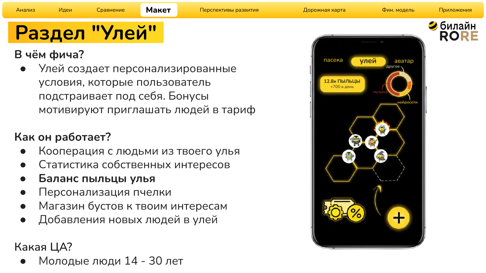
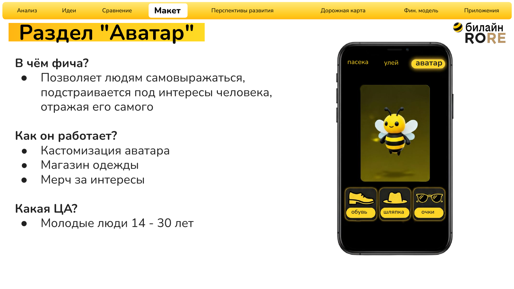
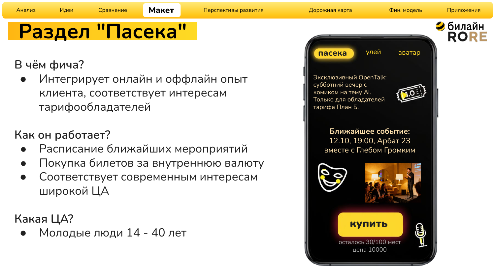
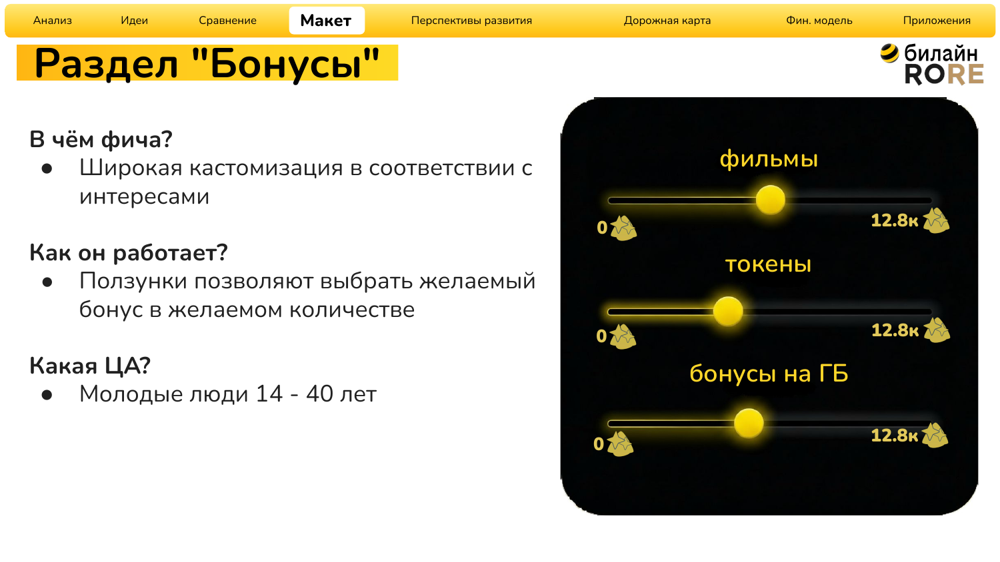

<h1>
  <a href="README.md"></a>
  <a href="README.ru.md"></a>
  Beeline / RORE — developing the Plan B mobile tariff
</h1>

[↩ Applied projects](https://github.com/levg00/levg00/blob/main/portfolio/applied.en.md)

A product concept for attracting customers to the Plan B mobile tariff and increasing engagement in its Telegram mini-app through social mechanics, personalization, and events.

🏆 **Final round of the Beeline / RORE case competition.** Our team passed all checkpoints and reached the final.


### 🖼️ [UI mockups](#prototype) · 📄 [Solution presentation](materials/presentation.ru.pdf)

## 🎯 Task

Increase the tariff's appeal and user activity in the mini-app while achieving a positive financial result.

## ⚡ My contribution and skills applied

- **Analytics:** developed the analytical part of the case to support the product solution.
- **Idea generation:** developed mechanics for user acquisition and engagement.
- **Interface design:** created mockups in Adobe Photoshop showing how the proposed mechanics should look in the mini-app.

## 💡 Team solution

Connect user groups, an internal currency called “pollen,” personalized bonuses, and events into a single system.

| Feature | What the user gets | Product hypothesis |
| :--- | :--- | :--- |
| 🐝 Hive | Shared bonuses and groups with other users | Motivation to invite friends |
| 🎟️ Apiary | Events and tickets purchased with “pollen” | Repeat visits to the mini-app and participation in the community |
| 🎨 Avatar and bonuses | Bee avatar customization and bonuses tailored to personal interests | Increased engagement |


<a name="prototype"></a>

## 🖼️ UI mockups

The visual mockups were created in **Adobe Photoshop** and are included in the presentation. Original mockups and presentation are in Russian.

**Hive section:** groups with other users, an internal currency balance, and bonuses tailored to personal interests.

[](materials/presentation.ru.pdf)

<details>
<summary><b>👀 Other mockups: Avatar, Apiary, and bonuses</b></summary>

**Avatar:** customizing the bee's appearance.



**Apiary:** an event schedule and tickets purchased with the internal currency.



**Bonuses:** choosing rewards based on personal interests.



</details>

## 🔎 Rationale for the solution

The team solution includes:

- Problem and goal definition, audience analysis, and SWOT.
- A review of competing solutions and event marketing.
- Comparison of ideas by cost, customer acquisition, and engagement.
- Selection of the AI Stand Up / Open Talk format from the proposed events.

## 📊 Metrics for evaluating the solution

- **Acquisition:** new subscriptions, acquisition cost, and referral program activity.
- **Engagement:** retention, time spent in the mini-app, and frequency of product use.
- **Economics:** revenue, costs, and LTV.
- **Community:** user-generated content.
- **Technical quality:** service availability, loading time, and interface smoothness.

<details>
<summary><b>Financial estimate</b></summary>

| Scenario parameter | Estimate |
| :--- | :--- |
| New users | 35,000 |
| Tariff price | RUB 490 per month |
| Monthly revenue at the specified number of new users | ≈RUB 17.2 million |
| Project budget | RUB 5 million |

</details>


## 📂 Materials

- [Original presentation — 34 slides, in Russian](materials/presentation.ru.pdf).

<details>
<summary><b>Files</b></summary>

```text
README.md                      — project description in English
README.ru.md                   — project description in Russian
assets/my-contribution.en.svg  — contribution banner in English
assets/my-contribution.ru.svg  — contribution banner in Russian
assets/hive.ru.png             — Hive section
assets/avatar.ru.png           — Avatar section
assets/events.ru.png           — Apiary section
assets/bonuses.ru.png          — bonus selection
materials/presentation.ru.pdf  — original team presentation in Russian
```

</details>
