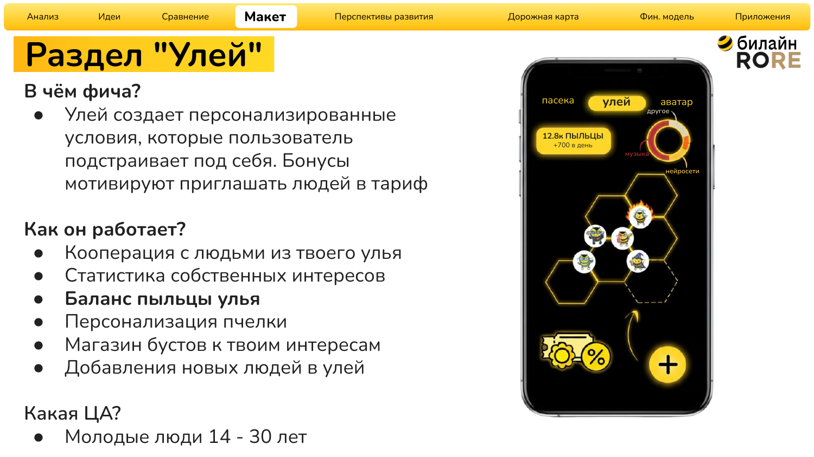
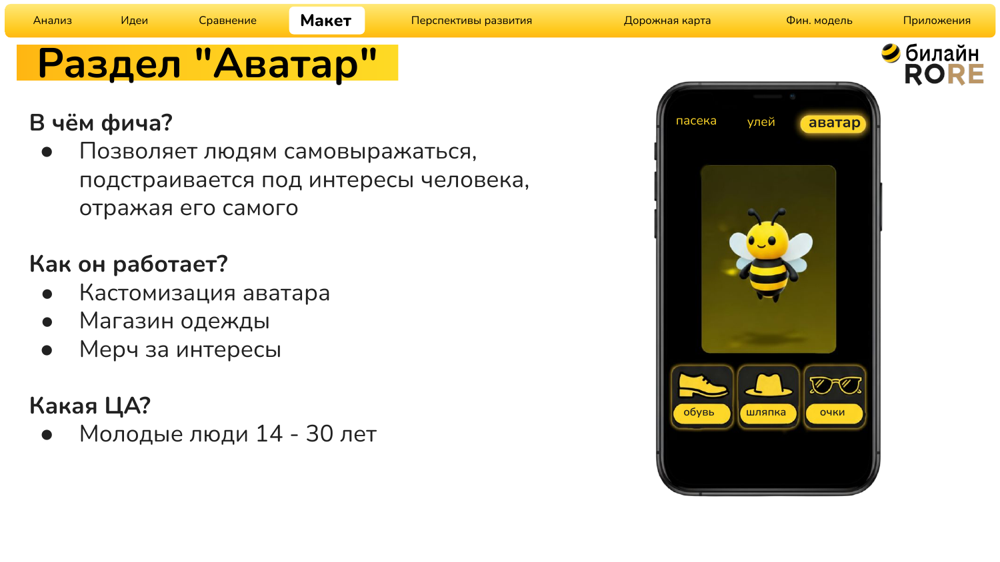
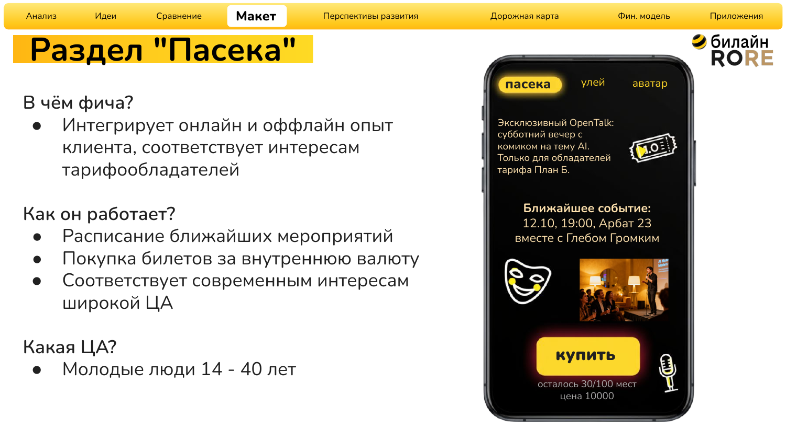
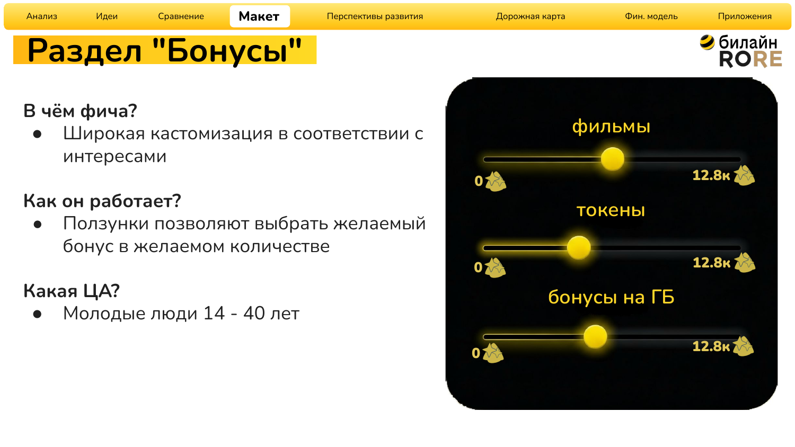

<h1>
  <a href="README.md"></a>
  <a href="README.ru.md"></a>
  Билайн / RORE — развитие тарифа «План Б»
</h1>

[↩ Прикладные проекты](https://github.com/levg00/levg00/blob/main/portfolio/applied.ru.md)

Продуктовая концепция для привлечения клиентов тарифа «План Б» и повышения вовлечённости в Telegram mini-app через социальные механики, персонализацию и мероприятия.

🏆 **Финал кейс-чемпионата «Билайн / RORE»**. Наша команда прошла все чекпоинты и вышла в финал.


### 🖼️ [Макеты интерфейса](#prototype) · 📄 [Презентация решения](materials/presentation.ru.pdf)

## 🎯 Задача

Повысить привлекательность тарифа и активность пользователей mini-app при положительном финансовом результате.

## ⚡ Мой вклад и применённые навыки

- **Аналитика:** разработал аналитическую часть кейса для обоснования продуктового решения.
- **Генерация идей:** разрабатывал механику привлечения и вовлечения пользователей.
- **Проектирование интерфейса:** создал макеты в Adobe Photoshop, показывающие, как предложенные механики должны выглядеть в mini-app.

## 💡 Решение команды

Связать объединение пользователей, внутреннюю валюту «пыльца», персональные бонусы и мероприятия в единую систему.

| Фича | Что получает пользователь | Продуктовая гипотеза |
| :--- | :--- | :--- |
| 🐝 Улей | Совместные бонусы и объединение с другими пользователями | Мотивация приглашать друзей |
| 🎟️ Пасека | Мероприятия и билеты за «пыльцу» | Повторные посещения mini-app и участие в жизни сообщества |
| 🎨 Аватар и бонусы | Персонализация пчёлки и выбор бонусов под интересы | Повышение вовлечённости |

<a name="prototype"></a>

## 🖼️ Макеты интерфейса

Визуальные макеты созданы в **Adobe Photoshop** и представлены в презентации.

**Раздел «Улей»:** объединение с другими пользователями, баланс внутренней валюты и бонусы под интересы.

[](materials/presentation.ru.pdf)

<details>
<summary><b>👀 Другие макеты: «Аватар», «Пасека» и бонусы</b></summary>

**Аватар:** настройка внешнего вида пчёлки.



**Пасека:** расписание мероприятий и покупка билетов за внутреннюю валюту.



**Бонусы:** выбор вознаграждений под собственные интересы.



</details>

## 🔎 Обоснование решения

В командном решении представлены:

- Постановка задачи и целей, анализ аудитории и SWOT.
- Обзор конкурентных решений и событийного маркетинга.
- Сравнение идей по затратам, привлечению клиентов и вовлечённости.
- Выбор формата AI Stand Up / Open Talk среди предложенных мероприятий.

## 📊 Метрики для оценки решения

- **Привлечение:** новые подключения, стоимость привлечения и активность реферальной программы.
- **Вовлечённость:** удержание, время в mini-app и частота использования продуктов.
- **Экономика:** выручка, затраты и LTV.
- **Сообщество:** пользовательский контент.
- **Техническое качество:** доступность сервиса, время загрузки и плавность интерфейса.

<details>
<summary><b>Финансовая оценка</b></summary>

| Параметр сценария | Оценка |
| :--- | :--- |
| Новые пользователи | 35 000 |
| Цена тарифа | 490 ₽ в месяц |
| Выручка за месяц при указанном числе новых пользователей | ≈17,2 млн ₽ |
| Бюджет проекта | 5 млн ₽ |

</details>

## 📂 Материалы

- [Исходная презентация — 34 слайда](materials/presentation.ru.pdf).

<details>
<summary><b>Файлы</b></summary>

```text
README.ru.md                    — описание проекта на русском
assets/my-contribution.ru.svg   — плашка личного вклада
assets/hive.ru.png              — раздел «Улей»
assets/avatar.ru.png            — раздел «Аватар»
assets/events.ru.png            — раздел «Пасека»
assets/bonuses.ru.png           — выбор бонусов
materials/presentation.ru.pdf   — исходная презентация команды
```

</details>
